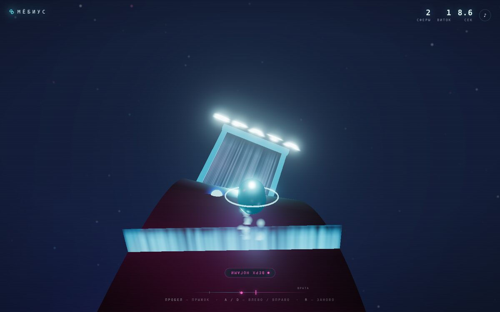
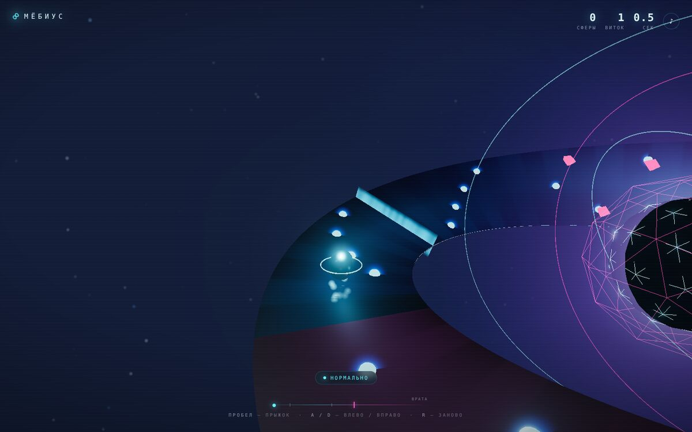
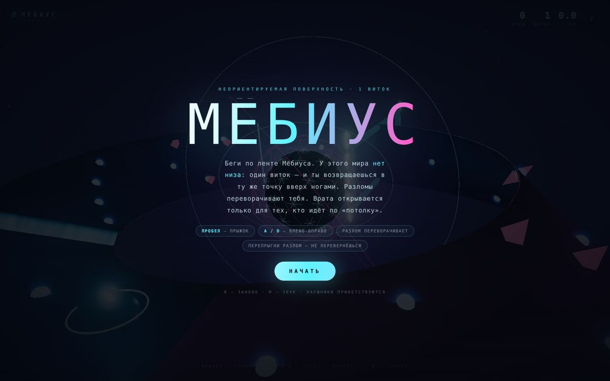

# МЁБИУС — 3D-мир без низа

**Раннер по ленте Мёбиуса.** Ты бежишь по неориентируемой поверхности: один виток — и
возвращаешься в ту же точку пространства **вверх ногами**. Разломы переворачивают тебя,
прыжок через разлом сохраняет ориентацию, а **врата открываются только тем, кто идёт по «потолку»**.



## Скачать и играть

Нужен один файл — интернет, сервер и установка не требуются.

**Прямое скачивание (одним кликом, архив — 160 КБ):**

### ⬇ https://github.com/Ritmirchic/Game/raw/arena/acada03b-game/mobius.zip

Распакуй и открой `mobius.html` двойным кликом — игра пойдёт прямо из файла, без сервера
и без интернета. Всё внутри: three.js, шейдеры, звук, уровни.

Если хочешь просто посмотреть код или скачать сам HTML:
[`mobius.html`](https://github.com/Ritmirchic/Game/raw/arena/acada03b-game/mobius.html)
(GitHub отдаёт .html как текст, поэтому для игры удобнее архив).

Клик-старт, звук генерируется в браузере — никаких ассетов и загрузок.

## Управление

| | |
|---|---|
| `пробел` / `W` / клик / тап | прыжок |
| `A` `D` / `←` `→` | сместиться по ленте к краю |
| `R` | начать заново |
| `M` | звук вкл/выкл |

На телефоне кнопки появляются сами.

## Правила этого мира

1. **Виток не замыкается.** Пробежав круг, ты оказываешься в исходной точке, но нормаль
   поверхности смотрит в другую сторону: для тебя перевернулся весь мир.
2. **Разлом** — светящаяся завеса поперёк ленты. Пересекаешь её на земле — тебя переворачивает.
   Перепрыгиваешь выше завесы — сохраняешь ориентацию.
3. **Врата** стоят на «изнанке». Войти в них можно только вверх ногами — то есть нужно
   подгадать, каким ты подойдёшь к арке.
   Две стороны ленты окрашены по-разному: **бирюзовая** — когда ты «нормальный»,
   **магентовая** — когда идёшь по «потолку». Переворот виден мгновенно.
4. Сферы добавляют очки, шипы сбивают темп. Витки ускоряются.





## Как это устроено

Вся физика живёт в координатах поверхности, а не в мировом пространстве:

```
x = (R + v·cos(u/2))·cos(u)
y = v·sin(u/2)
z = (R + v·cos(u/2))·sin(u)
```

- `u` — вдоль ленты, `v` — поперёк (в мировых единицах), `h` — высота над поверхностью
  в системе отсчёта игрока.
- Состояние игрока: `(u, v, h, u̇, v̇, ḣ, sign)`, где `sign = ±1` — на какой стороне ленты он стоит.
- Локальный репер `(tangent, normal, side)` считается из частных производных поверхности,
  поэтому «верх» игрока всегда совпадает с нормалью — и после разлома просто меняет знак.
- Персонаж — это меш, повёрнутый кватернионом из этого репера с дополнительным креном на
  `180°·sign`. Камера тоже следует за репером: «низ» экрана — это всегда «низ» игрока,
  иначе переворот был бы не виден.

Ключевой факт: `(u + 2π, v)` и `(u, -v)` — одна и та же точка пространства, но нормаль
в ней противоположна. Отсюда и весь геймплей. Проверяется тестами.

## Разработка

```bash
npm install
npm run dev      # http://localhost:5173 — сборка + сервер + автопересборка
npm run build    # dist/game.js + автономный mobius.html
node --test test/math.test.mjs
```

Стек: three.js (WebGL, EffectComposer + bloom), esbuild, ванильный JS. Никаких фреймворков,
никаких внешних ассетов: геометрия, текстуры, звук — всё генерируется кодом.

```
src/main.js    — мир, физика, камера, HUD
src/mobius.js  — параметризация ленты и реперы поверхности
src/audio.js   — синтезатор на WebAudio (дрон, переворот, подбор, победа)
test/          — тесты математики: ортонормированность, переворот нормали, окно прыжка
```

---

Сделано как эксперимент: «3D, но не обычное 3D». Здесь ось Y не является осью мира —
она является осью *игрока*.
