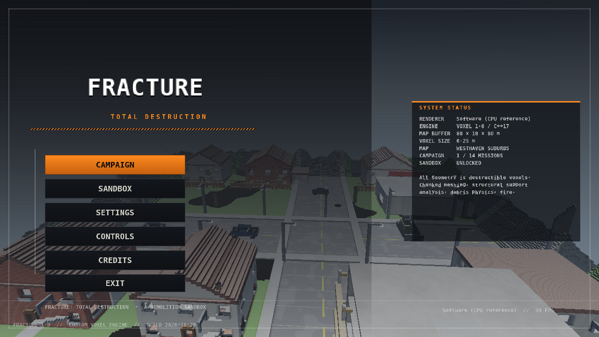

# FRACTURE: TOTAL DESTRUCTION

**An original first-person voxel demolition sandbox for Windows 10/11 (x64).**
Every wall, floor, roof, machine, vehicle and tree in the game is made of individually
destructible 25 cm voxels. Nothing is animation-only: hitting something removes geometry,
the mesh is rebuilt locally, physics debris is spawned and unsupported structures fall.



---

## Download

| Item | Direct link |
|---|---|
| **Game (Windows 10/11 x64, standalone, 1.2 MB)** | <https://github.com/Ritmirchic/Game/raw/refs/tags/fracture-v1.0.1/release/FRACTURE_TOTAL_DESTRUCTION.exe> |
| Source archive (zip, 299 KB) | <https://github.com/Ritmirchic/Game/raw/refs/tags/fracture-v1.0.1/release/FRACTURE_SOURCE.zip> |
| Whole repository at the release tag | <https://codeload.github.com/Ritmirchic/Game/zip/refs/tags/fracture-v1.0.1> |
| Release page | <https://github.com/Ritmirchic/Game/releases/tag/fracture-v1.0.1> |

## Play it

| Item | Path |
|---|---|
| **Game executable** | `release/FRACTURE_TOTAL_DESTRUCTION.exe` (standalone, no install) |
| Source archive | `release/FRACTURE_SOURCE.zip` |
| Test report | `docs/QA_REPORT.md` |
| Screenshots | `shots/qa/` (all captured from the real binary by the automated test harness) |

Run the exe directly — no engine, runtime, .NET, Visual C++ redistributable or editor is
needed. It creates `%APPDATA%\FRACTURE\` for settings, logs and sandbox saves.

**Requirements:** Windows 10 or 11, 64-bit, a GPU with OpenGL 3.3 (anything from ~2012 on).
If OpenGL cannot be created the game automatically falls back to the built-in CPU
renderer, so it starts even in a VM or over remote desktop.

---

## What you can do

* **Destroy anything.** 40 materials (concrete, reinforced concrete, brick, plaster, wood,
  steel, glass, asphalt, soil, stone, sandstone, containers, foliage…) with per-material
  resistance, debris type, flammability and footstep sounds.
* **Watch structures fail.** A support solver runs on freshly damaged regions: anything no
  longer connected to the ground becomes a falling physics piece.
* **12 tools**, each with real geometry effects: sledgehammer, shotgun, explosive charges,
  rocket launcher, blowtorch, plank bridge builder, fire extinguisher, grappling hook,
  industrial cutter, gravity cable, demolition drill, airstrike designator.
* **Fire and explosions.** Fire spreads across flammable material, heats props, collapses
  structures and is extinguished by water/CO2. Explosions carve craters, launch debris,
  start fires and knock out security hardware.
* **8 drivable vehicles** with suspension, terrain pitch/roll, voxel impact damage and
  bulldozing (sedan, pickup, heavy truck, bulldozer, forklift, armored truck, patrol boat,
  excavator with a digging bucket).
* **6 sandbox maps**: Westhaven Suburbs, Blackstone Industrial, Downtown Collapse, Harbor
  Breakdown, Red Canyon Test Range, The Grand Mall.
* **14-mission campaign** across 5 chapters, with destruction, reach, protect, timed,
  collect, vehicle-delivery and stealth objectives, rank scoring and unlocks.
* **Security systems**: sweeping cameras that raise alarms, sentry turrets that shoot back,
  and a lockdown timer.
* **Sandbox options**: time of day, weather, unlimited ammo, invulnerability, explosion
  power, vehicle spawning, and full save/load of the destroyed world geometry.
* **Full settings** where presets change real parameters (shadow map size, mesh detail
  budget, debris body budget, particle budget, view distance, render scale).

---

## Controls

| Input | Action |
|---|---|
| `W A S D` | move |
| Mouse | look / aim |
| `SHIFT` / `CTRL` / `SPACE` | sprint / crouch / jump |
| Left click | primary tool action |
| Right click | secondary action (heavy swing, scope, plank cancel…) |
| `1`–`9`, `0`, `-` / wheel | select tool |
| `R` | reload, detonate charges, reset plank/cable |
| `E` | interact: pick up, throw, enter/exit vehicle |
| `Q` | drop carried object |
| `F` | flashlight |
| `V` `T` `G` `N` `B` | sandbox: spawn vehicle, time of day, weather, reset map, spawn prop |
| `F3` `F5` `F9` `F1` `TAB` | minimap, quick save, quick load, debug overlay, controls |
| `ESC` | pause menu |

---

## How the engine works

Custom C++17, no third-party engine or libraries (only the Win32/WGL/OpenGL and WinMM APIs
that ship with Windows).

* **Voxel storage** — 32³ chunks of 8-bit material ids in a hash map, 21 bits per axis.
  Empty chunks are never allocated.
* **Meshing** — greedy meshing per chunk with per-vertex ambient occlusion and material ids;
  only chunks marked dirty are rebuilt, and rebuilds are time-sliced across frames so a
  large explosion never stalls the game.
* **Destruction** — `World::carve` tests a sphere against voxel *boxes* (so small tool radii
  always hit what you aimed at), accumulates damage on tough materials, and returns the
  affected AABB plus a per-material count for debris spawning.
* **Structural support** — coarse 4-voxel cells (≥9/64 solid) are flood-filled from the
  ground and the region border; disconnected clusters become physics pieces in budgeted
  batches.
* **Physics** — impulse-based rigid bodies against the voxel grid (swept AABB, friction,
  restitution, sleeping), with a hard body budget that recycles the oldest debris.
* **Rendering** — OpenGL 3.3 core: shadow-mapped sun, procedural material shading in the
  fragment shader (brick, concrete, wood grain, planks, metal panels, grating, asphalt, tiles,
  soil, shingles, rock, glass, container ribs), exponential fog, flashlight and explosion
  lights, bloom-ish post pass, FXAA, instanced boxes for props/vehicles/view models and
  instanced billboards for particles. A complete CPU software renderer (including a UI
  rasteriser) is used for headless verification and as a fallback.
* **Audio** — every sound is synthesised at start-up (oscillators, filtered noise,
  envelopes), mixed in 3D with distance attenuation and streamed through WinMM
  double-buffering; there are no audio files.
* **Saving** — modified chunks only, RLE-compressed, with the player state and sandbox
  options (a 1.1 M-voxel map with an explosion saves in ~5 KB).

---

## Building from source

```sh
# Windows executable (cross-build works from Linux with Zig 0.17)
./build_win.sh          # -> release/FRACTURE_TOTAL_DESTRUCTION.exe

# Linux/CI: software renderer + headless test suite
./build_linux.sh        # -> out/fracture_linux, out/fracture_tests
FRACTURE_DATA_DIR=/tmp/run ./out/fracture_tests --out /tmp/shots
```

`build_win.sh` needs `zig` on `PATH` (or `ZIG=/path/to/zig`); it produces a static PE32+
GUI binary with the icon and manifest embedded. `build_linux.sh` only needs `g++`.

Command-line switches: `--soft` (force the CPU renderer), `--gl`, `--headless`,
`--map N`, `--sandbox`, `--mission N`, `--out DIR --shots N --shot-frames N`.

---

## Known limitations

* The Windows binary was cross-compiled and validated (PE32+ structure, imports, icon and
  manifest resources, shader compilation), but **cannot be executed in this Linux build
  environment** — the visual screenshots come from the same game code running the software
  renderer on Linux. See `docs/QA_REPORT.md` for exactly what was and was not verified.
* The software renderer is a reference/fallback path (~4–8 fps at 720p); the GPU path is the
  shipping renderer.
* No multiplayer. No level editor. Vehicle bodies are rigid box rigs, not soft-body.

Everything in this repository (code, geometry, textures, fonts, icons, audio) is generated
by the project itself.
