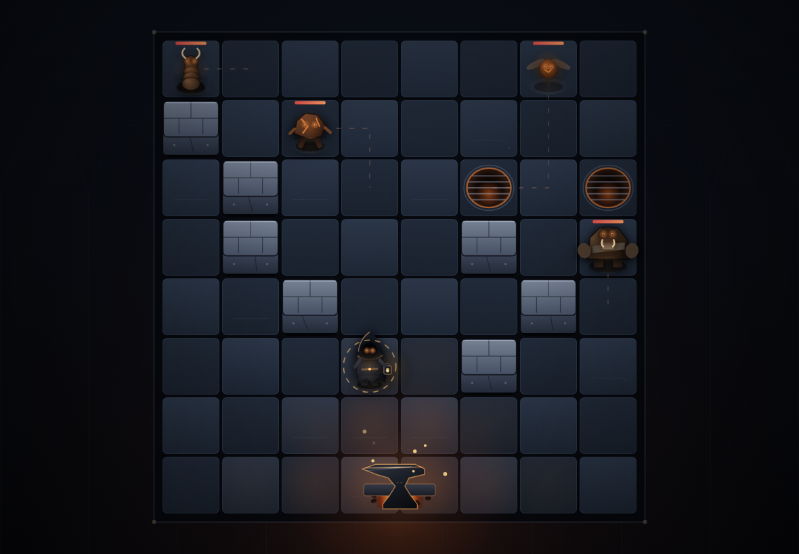

# ANVILIGHT

**A tactical grid roguelite about reading the future and shoving monsters into steam vents.**

▶ **Play in the browser** — <https://ritmirchic.github.io/Game/>



---

## What it is

The world went cold. One forge still burns, and everything that hates warmth is walking
toward it. You are its keeper.

Every enemy shows exactly which tile it will strike on the next enemy phase, and how much
damage it will do. Your turn is the puzzle: step out of the red, shove the attacker into a
wall or a steam vent, kill the thing that is chewing the forge, and spend your Heat where
it hurts most.

- 8×8 board, one move plus as many abilities as your Heat allows
- 18 abilities, 18 relics, 13 enemies, 3 bosses, 3 keepers
- 2 acts per run, 4 rooms plus a boss each — roughly 12–18 minutes
- Permanent dust, unlocks, achievements and a codex that remembers what you have met
- All art and audio generated at runtime: no sprite sheets, no audio files, no libraries
  beyond the bundler

## Controls

| Action | Input |
|---|---|
| Move | Click a highlighted blue tile |
| Use ability | Click the card (or `1`–`5`), then click a highlighted tile. `Esc` cancels |
| End turn | `Space` / `Enter` / End Turn button |
| Inspect a foe | Hover its tile (intent, damage, traits) |
| Pause / settings | `Esc` / gear button |
| Mute | `M` |

On touch devices the board scales and the ability belt becomes a horizontal strip.

## Running locally

```bash
npm install
npm run dev      # http://localhost:5173
npm test         # 54 automated tests (rules, progression, save, interface)
npm run build    # production build in dist/
npm run preview  # serve the production build
```

The build uses `base: './'`, so `dist/` works both at a GitHub Pages project sub-path and
from any static host or a local folder.

## Project layout

```
src/
  main.ts          application controller: screens, input, run flow, save wiring
  render.ts        canvas renderer: board, creatures, keepers, particles, telegraphs
  audio.ts         WebAudio synthesis (no audio assets)
  icons.ts         hand-authored inline SVG icon set
  styles.css       the whole interface design system
  core/
    types.ts       board, entities, events, vector helpers
    content.ts     heroes, abilities, relics, enemies, achievements, meta shop
    arena.ts       procedural arena generation with connectivity guarantees
    battle.ts      telegraph planning, resolution, damage, hazards, heat
    run.ts         rooms, encounters, rewards, shops, rests, difficulty curve
    save.ts        versioned localStorage save + achievement logic
    rng.ts         seeded deterministic RNG
tests/             vitest suites (rules, pacing, save sanitising, interface, CSS contract)
tools/             offline render harnesses used to produce shots/ (dev only)
archive/           the previous prototype that lived in this repository ("SLICE")
docs/              research notes and design documentation
```

## How it is tested

- `tests/battle.test.ts` — arena determinism and connectivity, telegraph commitment
  (moving makes an enemy miss), wall/vent shove damage, momentum relic, heat economy,
  Echo Anvil, line abilities, bombs, win/lose conditions, reinforcement waves.
- `tests/run.test.ts` — seed determinism, boss doors, encounter construction, reward
  filtering, belt cap, shop affordability, act/boss progression, a competent bot that
  plays rooms to measure difficulty, and save sanitising of hostile payloads.
- `tests/ui.test.ts` — jsdom boot of the real application: title, keeper select, route,
  battle HUD, pointer input on the canvas (move + cast), end turn, codex tabs, settings
  persistence, mute, help, Forgeworks.
- `tests/css.test.ts` — guards the pointer-events contract that keeps the board clickable
  and checks the stylesheet for unresolved markers.

Rendering cannot be pixel-verified without a browser in the build sandbox, so `tools/shots.ts`
and `tools/sheet.ts` render the real renderer offline (via `@napi-rs/canvas`) into
`shots/*.png`; those images are the art reference in this README.

## Known limitations

- Balance is tuned by simulation, not by human playtesting: the difficulty curve is
  measured with a scripted bot that only uses damage abilities.
- Desktop-first UI. Touch works (the board and belts reflow) but no gestures such as
  pinch-zoom are implemented.
- Audio is synthesised and deliberately sparse; there are no voice lines or licensed tracks.
- The mid-battle resume replays the fight from its start rather than restoring the exact
  turn.
- Progress lives in `localStorage` only — clearing site data clears the run.

## Credits

Design, code, art and sound: built as an original project for this repository. The previous
prototype in `archive/` ("SLICE") is kept for history and is not part of ANVILIGHT.
