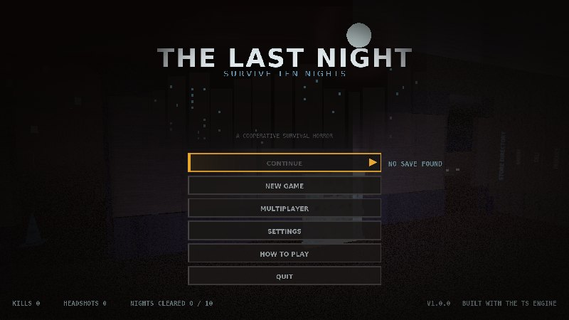

# THE LAST NIGHT

A single-player / LAN co-op survival-horror zombie defence game. You are trapped
in the **Save-N-Stock** supermarket. By day you search the aisles for supplies,
scrap and cash and spend it at the supply desk. By night the barricades have to
hold against ten escalating waves of the dead — including a mini-boss on night
five and the final boss, **The Storekeeper**, on night ten.



## Status of this build

| Deliverable | State |
|---|---|
| `THE_LAST_NIGHT.exe` (Windows x86-64, GUI subsystem, custom icon + version resource) | **built and verified as a PE image; not executed** — no Windows machine or emulator was available in the build environment |
| `THE_LAST_NIGHT_SETUP.exe` (installer) | **not produced** — no installer toolchain (Inno Setup / NSIS / MSI) could be downloaded, so the game ships as a portable folder + zip |
| `THE_LAST_NIGHT_SOURCE.zip` | built |

The Linux build of the exact same sources **was** executed, rendered and
play-tested headlessly (see `docs/TESTING.md`): 37 automated captures, a
two-process LAN replication test, ASan/UBSan runs. Anything in this README that
was not observed at runtime is called out in `docs/TESTING.md` under *Known
limitations*.

## Engine deviation (please read)

The brief asked for Unreal Engine 5, with Godot 4.x as fallback. **Neither was
obtainable in this environment**: there are no engine binaries available, and
GitHub release assets / CDNs (Epic, Godot, TuxFamily) are blocked, so no editor
or export template could be fetched. Rather than stall, the game is built on a
custom C11 engine written for this project (`engine/`), cross-compiled for
Windows with **Zig 0.17** (`zig cc --target x86_64-windows-gnu`, mingw-w64
runtime, `zig rc` for the icon/version resource). It is a real, self-contained
32/64-bit native build, not a wrapper around another runtime — but it is **not**
a UE5 or Godot game, and that is a deliberate, documented deviation.

## Running it

**Windows (portable):** unzip, keep `assets/` next to `THE_LAST_NIGHT.exe`,
run the exe. The game writes `the_last_night.log` next to itself.

**Linux (development build):**

```sh
gcc -O2 -std=c11 -o THE_LAST_NIGHT src/*.c engine/src/core.c engine/src/render.c \
  engine/src/threads.c engine/src/inflate.c engine/src/png.c engine/src/fileio.c \
  engine/src/png_write.c engine/src/geom.c engine/src/anim.c engine/src/audio.c \
  engine/platform/plat_headless.c -lm
./THE_LAST_NIGHT --headless --tour --shots shots/tour   # automated visual tour
```

The Linux target is headless by design (the project targets Windows for
interactive play); on Linux the game runs the simulation + renderer and writes
PNG captures and logs.

## Controls

| Input | Action |
|---|---|
| W A S D | move |
| Mouse | look |
| Left mouse | attack / fire |
| Right mouse | aim down sights |
| Shift | sprint (stamina) |
| Space | jump |
| R | reload |
| 1 – 8 / wheel | switch weapon |
| F | flashlight |
| H | medkit |
| E | interact / build / repair / buy |
| Tab (hold) | inventory & statistics |
| Esc | pause |

## What is in the game

* **Level** — a non-rectangular supermarket complex: main entrance, aisles,
  checkouts, produce, refrigerated and frozen sections, pharmacy, security
  office, back-of-house corridor, storage, loading dock, maintenance,
  electrical room, break room, plus parking lot, abandoned vehicles, delivery
  trucks, fences, streetlights and roads. Every room was connectivity-checked;
  all openings are reachable and the barricade slots line up with the doors.
* **Zombies** — walker, runner, crawler, brute and screamer, each with its own
  procedural model, skeleton, animation set, stats, AI behaviour and sound set;
  hit reactions, death animations, navmesh pathing with stuck recovery, and
  attacks that only land on line of sight (no hitting through walls).
* **Weapons** — fists, bat, axe, pistol, shotgun, assault rifle, hunting rifle,
  crossbow. Real geometry per weapon, view-model sway/recoil/ADS, reloads,
  magazines, spread, ballistics for the crossbow, muzzle flash lights, impact
  decals and hit reactions.
* **Barricades** — wooden, reinforced and welded metal upgrades per opening,
  health, damage states, destruction, traps (nail boards, barbed wire) and
  repair at the supply desk.
* **Nights** — ten nights with changing composition, count, concurrency, power
  state, lighting/fog, ambient events and wave structure — not just HP scaling.
  Night 5: **The Butcher**. Night 10: **The Storekeeper** boss with several
  attack patterns and adds.
* **Lighting** — baked ceiling fixtures + dynamic flashlight/muzzle lights with
  screen-space shadows, bloom, tonemap. The store is never fully black; the
  flashlight genuinely illuminates geometry (see `screenshots/`).
* **Audio** — fully synthesised at runtime: positional zombie vocals, footsteps,
  gunshots with tails, reload clicks, barricade impacts, rain, thunder,
  electrical hum and ambience.
* **UI** — custom-drawn menus, supply desk, settings, controls, inventory,
  weapon HUD, health/stamina, ammo, wave counter, prep timer, death and victory
  screens. No emoji, no stock widgets.
* **Multiplayer** — host-authoritative UDP over LAN/direct IP, up to 4 players.
  Host simulates everything at 20 Hz snapshots; clients send 30 Hz input and
  reconcile. Verified with a real two-process socket test (see
  `docs/TESTING.md`).

## Repository layout

```
src/            gameplay (level, AI, combat, weapons, models, UI, HUD, net)
engine/src/     renderer, math, animation, PNG/inflate, audio mixer, file I/O
engine/platform/plat_win32.c   Win32 window, DIB blit, raw mouse, waveOut
engine/platform/plat_headless.c Linux/CI harness
assets/         procedurally generated textures, fonts, UI art, icon
tools/          asset generation, Windows cross-build, LAN test scripts
docs/           BUILD / TESTING / CREDITS
screenshots/    captures from the automated tour
legacy/         the previous prototype that used to live in this repo
```

## Documentation

* [`docs/BUILD.md`](docs/BUILD.md) — toolchain, exact commands, cross-compilation
* [`docs/TESTING.md`](docs/TESTING.md) — what was actually run, results, limitations
* [`docs/CREDITS.md`](docs/CREDITS.md) — asset provenance and licences
