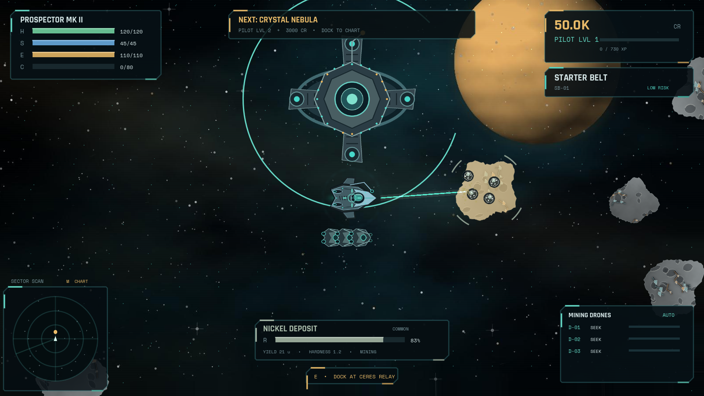

# SPACE MINER
## Deep Belt Operations

A complete top-down space mining adventure built with **Godot 4.4.1 / GDScript** for **Windows 10/11 x64**. Fly an original mining vessel, fracture mineral-bearing asteroids, tractor ore into your hold, trade at Ceres Relay, install meaningful upgrades, deploy visible autonomous drones, fight hostile ships, and chart five increasingly dangerous sectors.

Unreal Engine was not installed in the development environment. The official **Godot 4.4.1 stable** runtime was therefore verified and used, including native runtime execution and Windows export templates.



---

## Deliverables

| File | Purpose |
| --- | --- |
| `dist/SPACE_MINER.exe` | Standalone Windows x64 game; embedded game data, no runtime installation |
| `dist/SPACE_MINER_SETUP.exe` | Per-user NSIS installer, shortcuts, registered uninstaller |
| `dist/SPACE_MINER_SOURCE.zip` | Complete Godot project, original assets, asset pipeline, tests and build workflows |
| `docs/BUILD_REPORT.md` | Exported-build Windows verification, hashes and artifact sizes |
| `docs/TEST_RESULTS.md` | Test methodology and results |
| `docs/KNOWN_LIMITATIONS.md` | Platform and design limitations |

No internet connection, browser, Electron runtime, or external asset download is required to play.

## Controls

| Input | Action |
| --- | --- |
| `W A S D` / arrows | Thrust and strafe |
| Mouse | Aim ship and mining emitter |
| Hold left mouse | Mine the scanned asteroid; drains reactor energy |
| `Space` / right mouse | Fire pulse cannons |
| `Shift` | Afterburner; extra speed at an energy cost |
| `E` | Dock / undock within the Ceres Relay approach ring |
| `Tab` | Expand cargo manifest |
| `M` | Sector chart |
| `Esc` | Pause / close panel |
| `F11` | Toggle fullscreen |

A printable guide is installed as `PLAYER_GUIDE.txt` and is also available at [`docs/PLAYER_GUIDE.txt`](docs/PLAYER_GUIDE.txt).

## Game systems

### Five distinct sectors

1. **Starter Belt** — common ores, low threat, drifting micrometeors.
2. **Crystal Nebula** — lumen deposits, prismatic backdrop, reactor-disrupting resonance.
3. **Iron Graveyard** — salvage alloys, fast debris, coordinated raiders and heavy drones.
4. **Plasma Storm** — plasma ore, electrical telegraphs, area-denial lightning and plasma hunters.
5. **Void Frontier** — void crystals, neutronium, quantum cores, gravity wells and void sentinels.

Every sector has unique background art, six asteroid texture variants, resource weights, enemy composition, ambient audio, hazard behavior and progression requirements.

### Mining and economy

- Irregular physical asteroid silhouettes, collision polygons and rotation.
- Health, hardness, finite yield, progressive fracture shaders, hit flashes and damage states.
- A correctly aimed energy-consuming mining beam with sparks and collectible mineral fragments.
- Fifteen original resources with unique icons, rarity, value and hardness.
- Cargo limits, tractor collection, fixed-price selling, repair/service costs and rare-research discoveries.

### Progression and automation

- Credits, XP, pilot levels, sector clearances and four purchasable ship classes.
- Sixteen upgrades covering laser power, mining focus, cargo, speed, acceleration, hull, shields, reactor output, scanner range, drone slots, weapon damage, automatic collection, armour, auxiliary energy, drone overclocking and research.
- Every upgrade modifies a live simulation statistic; the automated suite verifies each one.
- Visible mining drones search, navigate, mine, collect fragments, return to the ship and deposit ore. Their power, speed, capacity and slot count are upgrade-driven.
- Twelve achievements and a research archive of discovered minerals.

### Combat and survival

Scout Drone, Raider Ship, Heavy Drone, Plasma Hunter and Void Sentinel use different movement patterns, ranges, shields, damage, attacks and rewards. Combat includes moving fire, projectile collision, shield absorption, hit effects, explosions, camera impact and death/insurance redeployment.

### Save system

The versioned JSON profile includes credits, cargo, discoveries, upgrades, ships, sectors, drones, achievements, statistics and settings. Saves use an exact-payload SHA-256 checksum, atomic temporary-file replacement, backup recovery, schema validation and corrupt-file quarantine.

## Original art and audio

The repository includes the final PNG/JPG/WAV assets and their deterministic generator, [`tools/generate_assets.py`](tools/generate_assets.py). Art is synthesized from hand-designed polygons, multi-octave noise, signed-distance forms, mineral veins, crater lighting, layered metal panels and procedural star fields. It contains no emoji, stock imagery, plain-circle planets, triangle ship substitutes or untextured asteroid placeholders.

- 5 nebula backgrounds with textured planets
- 30 asteroid variants
- 4 player hulls, 5 enemies, mining drone and orbital station
- 15 resource icons and 12 upgrade pictograms
- Particle textures, app icon and loading emblem
- 5 ambient soundscapes and 10 synthesized effects

Rajdhani and Space Mono are bundled under the SIL Open Font License; license texts are in `assets/fonts/`.

## Run from source

1. Install [Godot 4.4.1 standard edition](https://godotengine.org/download/archive/4.4.1-stable/).
2. Import `project.godot` in Godot.
3. Press **F6** on `scenes/main.tscn`, or **F5** to run the project.

Command line:

```bash
godot --path . --editor --quit
godot --path .
```

No plugins or GDExtensions are required. The project uses the compatibility renderer and native `CharacterBody2D`, `RigidBody2D`, `Area2D`, `GPUParticles2D`, `ShaderMaterial`, `Camera2D` and custom `CanvasLayer` UI.

## Tests

Run the real scene-tree suite with an isolated profile:

```bash
# Linux example; any writable temporary data directory works
XDG_DATA_HOME="$PWD/.test-data" godot --headless --path . --script res://tests/test_runner.gd
```

The suite covers resource/data integrity, every upgrade effect, economy, cargo limits, sector and ship unlocks, save round-trips and corruption, actual world boot, physics movement, camera, spawn clearance, mining, destruction, Area2D collection, drone mining/deposit, enemy AI, projectiles, rewards, all sector generation, UI screens and button wiring.

Rendered visual route:

```bash
godot --path . --resolution 1600x900 --script res://tests/capture.gd
```

This runs the actual game and saves menu, flight, mining, combat, station, map, settings, achievement and sector frames to `shots/`.

## Windows export

Install the matching **Godot 4.4.1 export templates**, then:

```bash
godot --headless --path . --export-release "Windows x64" "$PWD/dist/SPACE_MINER.exe"
```

The preset embeds the PCK, uses the original `.ico`, adds application version metadata and disables the console wrapper. `tools/installer.nsi` builds `SPACE_MINER_SETUP.exe` with NSIS. The included GitHub Actions workflow performs the official-template export, validates the PE image, runs the exported game on Windows, silently installs it, and tests the installed executable.

To regenerate assets (not needed to play or build):

```bash
python3 -m venv .venv
.venv/bin/pip install pillow numpy
.venv/bin/python tools/generate_assets.py
```

## Source layout

```text
project.godot                 Godot project and custom boot splash
export_presets.cfg            Windows x64 release preset
scenes/                       Main scene
scripts/
  data.gd                    Resources, sectors, upgrades, ships, enemies, achievements
  game_state.gd              Economy, progression and live statistics
  save_system.gd             Versioned validated atomic saves
  world.gd                   Sector simulation and combat coordination
  ship.gd                    CharacterBody2D flight and damage model
  asteroid.gd                RigidBody2D rocks, health, yield and damage states
  drone.gd                   Autonomous mining state machine
  enemy.gd                   Five combat AI patterns
  pickup.gd                  Area2D resource collection
  projectile.gd              Friendly and hostile projectiles
  effect.gd / hazard.gd      Explosions, fragments, storms and gravity wells
  hud.gd / interface.gd      Custom flight HUD and complete UI
  audio.gd                   Music and SFX routing
assets/                       Final original art, audio, fonts and shaders
tests/                        Runtime assertions and rendered capture route
tools/                        Deterministic asset generator and NSIS script
docs/                         Player guide, tests, release report and limitations
```

---

**SPACE MINER 1.0.0 · Ceres Interactive · Built with Godot 4.4.1**
