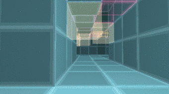

# СРЕЗ / SLICE

**Игра в четырёх измерениях.** Один HTML-файл, ноль зависимостей, ноль картинок и звуковых файлов.

▶ **Играть: [`index.html`](index.html)** — просто открыть в браузере (или скачать одним файлом).



---

## Что это

Мир игры — настоящая **четырёхмерная воксельная решётка 32⁴**. Четыре трёхмерных лабиринта
лежат в одном и том же месте и отличаются только координатой **W** — той осью, которую игрок
не видит. Ты — трёхмерный срез четырёхмерной решётки.

Ключевая механика: **стена перед тобой может существовать только в соседнем измерении**.
Тогда она не останавливает тебя, но просвечивает сквозь пустоту цветными рёбрами —
и по ней понятно, куда сдвигать W. Сдвиг по W мгновенно заменяет всю геометрию вокруг:
стена становится воздухом, воздух — стеной, а коридор уходит в другом направлении.
Есть и обратный эффект: **дверь-эхо** — проход, который в твоём срезе непроходим, но виден
как вход в другое измерение.

Цель — собрать 4 резонансных фрагмента, по одному на каждой глубине (каждый спрятан
в камере, которая существует только в своём срезе), и вернуться к ядру на глубине 0.

## Управление

| действие | клавиши |
|---|---|
| идти | `W` `A` `S` `D`, `Shift` — бег |
| обзор | мышь (клик по экрану — захват курсора), на телефоне — правый свайп |
| сдвиг по W вперёд / назад | `ЛКМ` / `ПКМ`, `E` / `Q`, `↑` / `↓` |
| пауза | `Esc` |
| звук | `M` |

На тач-устройствах появляется стик и кнопки `W +` / `W −`.

## Как это сделано

* **Рендер** — собственный софтверный рейкастер (`src/render.js`), без WebGL и без библиотек.
  Для каждого пикселя пускается луч по 3D-решётке (DDA), но на каждой клетке проверяется
  не только «моё» измерение, а вся 4D-колонка: `occ[cell]` — байт с битовыми масками
  (биты 0–3 — порода по срезам W, биты 4–7 — призрачная материя). Клетки, свободные в моём
  срезе и занятые в чужом, рисуются как светящиеся грани, и луч идёт дальше — отсюда
  полупрозрачная «невозможная» геометрия и вид на несколько измерений сразу.
* **Мир** — генератор (`src/world.js`): каркас общих коридоров, 4 уникальных среза
  с разной призрачной архитектурой, 4 тайные камеры, лампы, которые горят во всех срезах.
* **Звук** — синтез на WebAudio: дрон-пэд, тональность которого зависит от глубины,
  шум-«схлопывание» при сдвиге, шаги. Ни одного аудиофайла.
* **Интерфейс** — миникарта среза, компас на ближайшую цель в любом измерении,
  зонд «сквозь эту пустоту просвечивает глубина N», адаптивное разрешение рендера.

### Исходники

```
index.html              ← собранная игра (единственный нужный файл)
src/world.js            ← генератор 4D-мира
src/render.js           ← 4D ray-voxel рендер
src/game.js             ← игровая логика, звук, HUD
src/index.template.html ← оболочка и стили
tools/build.js          ← сборка одного файла из src/*
tools/check.js          ← проверка мира (достижимость) + рендер кадров в shots/
tools/smoke.js          ← headless-смоук-тест через jsdom
tools/preview.js        ← генерация shots/preview.gif
```

Сборка:

```bash
node tools/build.js     # index.html из src/*
node tools/check.js     # проверка проходимости всех четырёх срезов
```

Сид мира фиксирован (`20261025`) — лабиринт всегда один и тот же, прохождение сравнимо.

---

Сделано на Arena.ai · 4D RAY-VOXEL ENGINE · решётка 32⁴ · рендер на CPU
