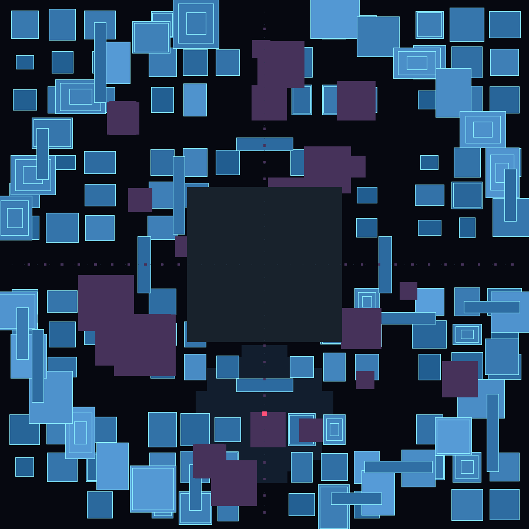

# MEMORIA — город, которого не было

**3D-игра на 5 минут, в которой мира нет, пока ты его не вспомнил.**
Ни одна башня не существует заранее: город собирается из тьмы там, где ты прошёл,
и снова рассыпается в дизеринг-пыль, если отойти слишком далеко. Улицы, башни и арки — это твоя память,
и у неё есть таймер.

> Пол неба, пол-зеркало: весь город отражается в бесконечном чёрном зеркале под ногами.
> Наверху — аврора и звёзды. Внизу — ты и то, что ты сумел вспомнить.

---

## Как играть

**Скачай один файл и открой его в браузере** — сервер, интернет и зависимости не нужны:

- ⬇ **скачать архивом (прямая ссылка):** <https://github.com/Ritmirchic/Game/archive/refs/tags/v4.0.0.zip>
  → распаковать → открыть **`MEMORIA.html`** (одним файлом, вся игра внутри, ~100 КБ) или `index.html`.
- **`MEMORIA.html`** лежит и в корне репозитория — его можно просто сохранить кнопкой «Download raw file».
- Ветка с исходниками: <https://github.com/Ritmirchic/Game/tree/arena/ce306eff-game>

Игра работает и просто из репозитория: открой `index.html` (классические `<script>`, поэтому `file://` тоже ok).

| Действие | Клавиши |
|---|---|
| Идти | `W` `A` `S` `D` / стрелки |
| Смотреть | мышь (клик — захват курсора) |
| Бежать | `Shift` |
| Взлететь / подняться | `Пробел` (удерживать) |
| Спуститься | `Ctrl` |
| **Импульс памяти** (вспомнить всё вокруг разом) | `E` или левая кнопка мыши |
| Компас к ближайшему забытому | `H` |
| Другой город (новый сид) | `R` |
| Звук | `M` |
| Пауза | `Esc` |

Цель: **вспомнить 100% города за 5 минут**. Процент = сколько зданий из ~160 ты уже вернул.
Импульс перезаряжается 5.5 секунды — прибереги его для тёмных углов.

---

## Что здесь нового

1. **Мир как след памяти.** Геометрия не «загружена», а нарисована процедурно, но видна только внутри
   радиуса твоего внимания. Всё остальное — редкие искры-контуры в тумане. Это не туман войны поверх карты,
   а сама материя: каждая грань сравнивается с картой памяти (текстура 64×64, тайлы 2×2 м) прямо во фрагментном шейдере.
2. **Материализация дизерингом.** Крыша каждой башни «прорастает» вверх со скоростью, зависящей от расстояния,
   а видимость граней решается упорядоченным дизерингом Байера по экранным координатам — получается
   не альфа-блендинг, а честное «проявление» пикселей, как на старом плоттере или в кинохронике.
3. **Зеркальный пол в один проход.** Город рендерится второй раз с инвертированной по Y геометрией
   в половинный render target, а пол читает его по проекции точки отражения — с рябью от шагов и импульсов.
   Поэтому отражение живое: оно дрожит, когда ты идёшь.
4. **Всё своё.** Свой WebGL-рендерер (WebGL2 с фоллбэком на WebGL1), своя математика матриц, свой
   процедурный звук (аккорды-колокола, дрон из пяти голосов, шум шагов) — без three.js и без единой внешней загрузки.
   Итог: ~100 КБ на всю игру, запускается мгновенно и офлайн.

## Как это устроено

```
index.html        UI: меню, HUD, финальные экраны
src/world.js      генерация города (детерминированный сид), карта памяти, коллизии, прогресс
src/gl.js         обёртка WebGL + mat4
src/game.js       шейдеры, геометрия, игровой цикл, ввод, звук-хаки
src/audio.js      генеративный WebAudio: дрон, колокола, вихрь финала
tools/build.mjs   собирает dist/MEMORIA.html (single-file) и dist/MEMORIA.zip
tools/headless-smoke.mjs  прогон всей игры без браузера (мок WebGL/DOM)
tools/map-preview.mjs     карта сгенерированного города в PNG
tools/view-preview.mjs    оффлайн-превью камеры (каркас) для проверки композиции
```

Город детерминирован: `seed` даёт один и тот же город. Четыре квартала 23×23 м, авеню по осям,
внешнее кольцо башен, арки-ворота, висячие мосты между близкими крышами, парящие осколки и фонари.



## Проверка без браузера

В песочнице, где игра писалась, не было GPU, поэтому появился мок: он поднимает DOM и WebGL-заглушку
и прокручивает настоящий игровой цикл (меню → старт → ходьба → полёт → импульс → таймер до нуля).

```bash
node tools/headless-smoke.mjs 0 play   # 1000+ кадров, ходьба/полёт/импульс
node tools/headless-smoke.mjs 0 lose   # форсированный конец таймера
node tools/map-preview.mjs 7 tools/map.png
```

## Технические детали

- **Геометрия**: статический буфер треугольников + буфер линий; при проявлении здания обновляется
  только диапазон его вершин (`bufferSubData`), анимированные объекты пересобираются на CPU каждый кадр.
- **Память**: `Uint8Array` 64×64×2 (revealed / presence) → RGBA-текстура → шейдеры пола и зданий.
  Проявление идёт по тайлам 2×2 м, поэтому видимость зданий включается «по площади», а не по центру.
- **Совместимость**: WebGL2 предпочтительно, WebGL1 — с `WEBGL_depth_texture`/`ANGLE_instanced_arrays`
  фоллбэком; шейдеры написаны на GLSL ES 1.00, чтобы работали в обоих. Звук стартует по первому клику.
- **Производительность**: ~2.8k draw-вызовов на 1000 кадров, 4 буфера, 3 текстуры, без зависимостей.

---

Сделано с любовью к пустоте, которую нужно заполнить.
