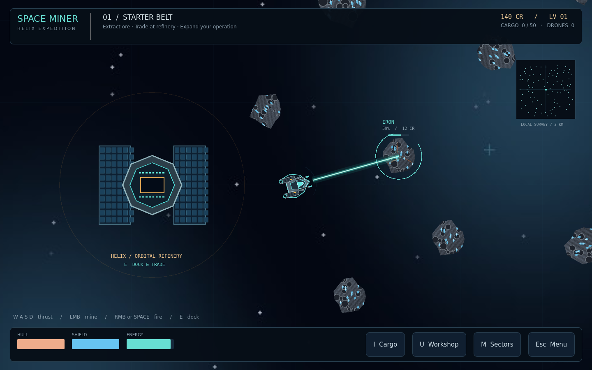

# SPACE MINER — The Helix Expedition

A playable original Godot 4 mining, exploration, combat and automation game.

## Downloads
- [Windows x64 portable](delivery/SPACE_MINER_WINDOWS.zip) — includes **SPACE_MINER.exe**
- [Windows installer](delivery/SPACE_MINER_SETUP.exe) — per-user installation and uninstallation
- [Complete source project](delivery/SPACE_MINER_SOURCE.zip)
- [Browser build](delivery/SPACE_MINER_WEB.zip)
- [Linux x86_64](delivery/SPACE_MINER_LINUX.zip)

**Play the running preview on port 8000.** Source: [`space_miner/project.godot`](space_miner/project.godot). Open it in Godot **4.7.1**.

## Gameplay
Mine textured asteroids, collect fifteen minerals, sell at orbital refineries, develop twelve real upgrade branches, buy three ship classes, research five sectors, fight five hostile classes, and deploy visible autonomous mining drones. Versioned saves, corruption recovery, settings and eight achievements are included.

**WASD** thrust · **LMB** mine · **RMB / Space** fire · **E** dock · **I** inventory · **U** upgrades · **M** map · **O** drones · **Esc** pause.

- [Player guide](space_miner/PLAYER_GUIDE.md)
- [Source and build documentation](space_miner/README.md)
- [Test results and limitations](space_miner/TEST_RESULTS.md)

Windows packages are unsigned. Automated tests cover 44 gameplay/persistence assertions, Linux release startup, actual browser input/rendering, Windows headless executable startup, and silent installation, installed startup and uninstallation on a Windows runner. This does not replace manual GPU/gameplay testing across Windows hardware.

## Existing repository content
The original **СРЕЗ / SLICE** browser game is preserved without changes in `index.html`, `src/`, `tools/` and `shots/`. Its previous README is [SLICE_README.md](SLICE_README.md). Space Miner is intentionally isolated in `space_miner/`.
